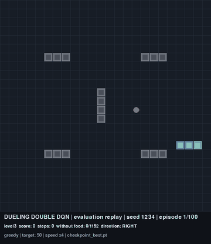

# Snake RL: Dueling Double DQN and Zero-Shot Transfer

Course project for **REL301c** (Reinforcement Learning), FPT University.

**Team:** Nguyen Duc Manh (manhndse180326@fpt.edu.vn), Hoang Van Anh (anhhvse180142@fpt.edu.vn).

A **Dueling Double DQN** agent is trained only on **Level 4** of the Snake game. The network is then frozen and played **without retraining** (zero-shot) on five other levels with different board sizes and obstacle layouts. Research question: how well does a policy learned in a single environment transfer to other environments?



*Level 3 (24×24, 16 obstacles), evaluation seed 1234, speed ×4. This is a real episode from the evaluation set, not a hand-picked one.*

## Demo video

[**Watch the full demo video (MP4, 2 min 12 s)**](docs/demo/snake_dqn_demo.mp4)

The video replays seven real evaluation episodes with `checkpoint_best.pt` under greedy control (no random actions):

| Clip | Level | Seed | Outcome |
|---|---|---:|---|
| 1 | Level 1 | 1234 | Reached target 25 |
| 2 | Level 2 | 1234 | Reached target 35 |
| 3 | Level 3 | 1234 | Reached target 50 |
| 4 | Level 4 (training) | 1234 | 122 points, self-collision |
| 5 | Level 5 | 1234 | Reached target 100 |
| 6 | Level 6 | 1234 | Reached target 150 |
| 7 | Level 6 | 1235 | **Failure:** stuck in an early loop, timed out at 1 point |

**Episode selection rule:** the first evaluation seed (1234) on every level, plus the first Level 6 failure to illustrate the main failure mode. The recording script checks that every replayed episode matches the score, outcome, and step count in `results/cross_level_evaluation/episodes.csv`, and stops on any mismatch.

## Main results

Greedy evaluation, 100 episodes per level, with the same 100 seeds (1234–1333) on every level:

| Level | Board | Obstacles | Target | Mean score ± SD | Target success | Random policy |
|---|---:|---:|---:|---:|---:|---:|
| 1 | 15×15 | 0 | 25 | 25.00 ± 0.00 | 100% | 0% |
| 2 | 20×20 | 8 | 35 | 33.98 ± 5.80 | 97% | 0% |
| 3 | 24×24 | 16 | 50 | 46.58 ± 12.47 | 93% | 0% |
| **4 (training)** | **30×30** | **20** | **none** | **144.49 ± 27.28** | – | – |
| 5 | 32×32 | 34 | 100 | 75.40 ± 42.29 | 74% | 0% |
| 6 | 36×36 | 68 | 150 | 88.71 ± 71.77 | 54% | 0% |

**What the results show:**

- **Transfer is real.** The model never saw Levels 1, 2, 3, 5, or 6, yet it reaches the target in most episodes. The random policy never reaches a target.
- **Transfer weakens on larger, more obstructed boards.** Success drops to 74% on Level 5 and 54% on Level 6.
- **The weakness is at the start of an episode.** On unseen levels, most failures are timeouts while the snake is still short (median score at timeout: 1). Episodes that reach 10 food items finish in 318 of 325 cases.
- **Longer training does not reliably improve transfer.** The final checkpoint is stronger on Level 4 (153.83), but its success rates do not differ significantly from the best checkpoint (exact McNemar test with Holm correction).
- **Training scores are lower than evaluation scores because of exploration.** The training moving average is about 44–52. Adding ε = 0.01 back during evaluation drops the Level 4 score to 43.58, the same level as during training.

The full analysis is in the IEEE-style report `latex/main.tex`.

**Limitations:** one training seed; training on a single level; the levels differ in size, obstacles, and target at the same time, so the effect of each factor cannot be isolated.

## Project structure

```text
Snake_AI/
├── configs/
│   ├── envs/                      # six levels: board size, obstacles, target
│   └── experiments/
│       └── dqn_final_mastery.yaml # hyperparameters of the final model
├── src/
│   ├── agents/dqn/                # dueling network, Double DQN agent, replay buffer
│   ├── envs/                      # SnakeEnv, 27-feature state encoder, pygame renderer
│   └── utils/config_loader.py     # level YAML loader
├── scripts/
│   ├── train_final_dqn.py         # continuous training on Level 4, with resume
│   ├── play_final_dqn.py          # watch the model play in a pygame window
│   ├── evaluate_cross_level.py    # greedy evaluation on six levels
│   ├── evaluate_epsilon_effect.py # greedy versus ε = 0.01 on Levels 4, 5, 6
│   └── record_demo.py             # record the demo GIF and video from evaluation episodes
├── results/
│   ├── level4_continuous_dqn/     # training log and checkpoints
│   ├── cross_level_evaluation/    # six-level evaluation results
│   └── epsilon_effect/            # greedy and ε = 0.01 results
├── tests/                         # pytest for environment, rewards, agent
├── docs/demo/                     # demo GIF and video
├── latex/
│   ├── main.tex, references.bib   # IEEE report
│   ├── generated/                 # figures and tables generated from results/
│   ├── scripts/                   # figure, slide, and preview scripts
│   └── slides/                    # presentation slides and speaker notes
└── web_demo/                      # FastAPI demo that runs the model in the browser
```

## Environment

| Level | Board | Obstacles | Episode target | Role |
|---|---:|---:|---:|---|
| Level 1 | 15×15 | 0 | 25 | Evaluation |
| Level 2 | 20×20 | 8 | 35 | Evaluation |
| Level 3 | 24×24 | 16 | 50 | Evaluation |
| **Level 4** | **30×30** | **20** | **No limit** | **Training** |
| Level 5 | 32×32 | 34 | 100 | Evaluation (holdout) |
| Level 6 | 36×36 | 68 | 150 | Evaluation |

Layout figure of the six levels: `latex/generated/level_layouts.png`.

An episode ends when the snake dies (wall, obstacle, or own body), when the board is full, when the target is reached (on levels with a target), or on timeout. A timeout occurs when the snake moves `2 × number of board cells` steps without eating.

A timeout only **truncates** the episode; it is not a real death. The environment returns `info["truncated"] = True`, and the trainer stores that transition as non-terminal, so it still bootstraps from the next state. In the published run, no training episode ended by timeout, so this rule did not affect the model.

Rewards: food +10, death −20, each step −0.005, plus +0.02 when moving closer to the food or −0.02 when moving away. Rewards are used only for learning; evaluation measures only the score (food eaten).

## Actions and state

The model uses three actions relative to the current heading:

```text
0 = STRAIGHT
1 = TURN_RIGHT
2 = TURN_LEFT
```

Relative actions mean the snake can never choose to reverse into itself, and they keep the same meaning on every board size.

The state is a fixed 27-dimensional vector that does not depend on board size, so one network runs on every level:

| Feature group | Dimensions |
|---|---:|
| Immediate danger (straight, right, left) | 3 |
| Current heading (one-hot) | 4 |
| Food position relative to the head | 4 |
| Ray clearance in three directions (normalized) | 3 |
| Row and column distance to food (normalized) | 2 |
| Head position (normalized) | 2 |
| Snake length over free cells | 1 |
| Safe area after each action (bounded BFS) | 3 |
| Tail position relative to the head, head–tail distance | 5 |

The safe-area features help the agent detect dead ends once the snake is long.

## Algorithm

- **Dueling network:** two-layer MLP with 256 units, split into a V(s) stream and an A(s, a) stream.
- **Double DQN:** the online network selects the next action and the target network evaluates it, which reduces Q-value overestimation.
- Huber loss, gradient clipping at 10, Adam with learning rate 3×10⁻⁴, γ = 0.995.
- Replay buffer of 300,000 transitions, batch size 256, one update every 2 steps, target network synchronized every 5,000 steps.
- ε decays linearly from 1.0 to 0.01 over 400,000 steps.
- Training runs only on Level 4 until the user presses `Ctrl+C`.

Full config: `configs/experiments/dqn_final_mastery.yaml`.

## Installation and tests

Requirements: Windows, Python 3.11.

```powershell
python -m pip install -r requirements.txt
python -m pytest -q
```

`requirements.txt` pins the verified versions: with them, the tests pass and greedy evaluation reproduces the published results exactly. On Windows, `torch` from PyPI is the CPU build, which is enough for playing, evaluation, and the web demo. For GPU training, install the CUDA build first by following https://pytorch.org/get-started/locally/. An RTX 5070 Ti needs a CUDA build that supports `sm_120` (for example CUDA 13.2).

## Trained models

| File | Purpose |
|---|---|
| `results/level4_continuous_dqn/seed_0/checkpoint_best.pt` | **Main model.** Used by the report, web demo, video, and play script |
| `results/level4_continuous_dqn/seed_0/final_model.pt` | Model at the end of training, for comparison only |
| `results/level4_continuous_dqn/seed_0/checkpoint_latest.pt` | Includes the replay buffer, used only for `--resume` |

Published run: seed 0, 19,094 episodes, 14,293,725 steps, trained on GPU.

`checkpoint_best.pt` was selected by the highest 100-episode moving average at the save points (every 250 episodes, after a 500-episode warm-up): 52.09 at episode 17,000.

All checkpoints are smaller than 100 MB and are stored directly in Git, without Git LFS.

## Watching the model play

```powershell
# Level 4
python scripts/play_final_dqn.py --level level4 --episodes 1 --fps 30

# All six levels in turn
python scripts/play_final_dqn.py --level all --episodes 1 --fps 60

# Progression 1 → 2 → 3 → 5 → 6; a level is replayed until its target is reached
python scripts/play_final_dqn.py --level progression --episodes 1 --fps 60

# Another checkpoint
python scripts/play_final_dqn.py --checkpoint results/level4_continuous_dqn/seed_0/final_model.pt --level all
```

## Training

Without rendering, at full speed:

```powershell
python scripts/train_final_dqn.py
```

Watch one episode after every 100 training episodes, drawing every 2 steps at 60 FPS:

```powershell
python scripts/train_final_dqn.py --render --render-every 100 --render-fps 60 --render-frame-skip 2
```

`--render-frame-skip` only skips displayed frames; it does not skip training transitions.

Use a separate output directory, or set a step budget:

```powershell
python scripts/train_final_dqn.py --seed 1 --output-dir results/level4_seed1
python scripts/train_final_dqn.py --max-env-steps 10000000
```

### Stopping and resuming

Press `Ctrl+C` once. Wait until the terminal reports that the checkpoint is saved and returns the prompt. The checkpoint contains the network, optimizer, epsilon, step counters, and replay buffer.

```powershell
python scripts/train_final_dqn.py --resume
```

Resuming appends to `episodes.csv` instead of restarting at episode 1. To start a completely new run, use a new `--output-dir`.

### Training output

```text
results/level4_continuous_dqn/seed_0/
├── episodes.csv          # one row per episode
├── checkpoint_latest.pt
├── checkpoint_best.pt
├── best_training.json
├── final_model.pt
└── run_status.json
```

`episodes.csv` records: global step, score, reward, steps, steps per food, termination cause, epsilon, buffer size, update count, Huber loss, TD error, current and target Q, gradient norm, moving average, and best score.

## Evaluation

Greedy evaluation of `checkpoint_best.pt`, `final_model.pt`, and a random baseline, 100 episodes per level:

```powershell
python scripts/evaluate_cross_level.py --episodes 100
```

Greedy versus ε = 0.01 on Levels 4, 5, 6 (about 10 minutes on CPU; choose levels with `--levels`):

```powershell
python scripts/evaluate_epsilon_effect.py
python scripts/evaluate_epsilon_effect.py --levels level4
```

Each evaluation writes per-episode results, a summary table, and `metadata.json` (checkpoint hash, seeds, library versions, Git commit).

## Re-recording the demo video

`imageio-ffmpeg` is needed only for recording:

```powershell
python -m pip install imageio-ffmpeg==0.6.0
python scripts/record_demo.py
```

The script runs headless, without opening a window, and takes less than a minute. Output goes to `docs/demo/`.

## Report, slides, and web demo

- **Report** in IEEE format: `latex/main.tex`. Figures and tables are generated from `results/` by `latex/scripts/generate_report_assets.py`. Build instructions: see `latex/README.md`.
- **Slides** (21 slides with Vietnamese speaker notes): `latex/slides/`. See `latex/slides/README.md`.
- **Web demo** (FastAPI, watch the model play in the browser): see `web_demo/README.md`.
